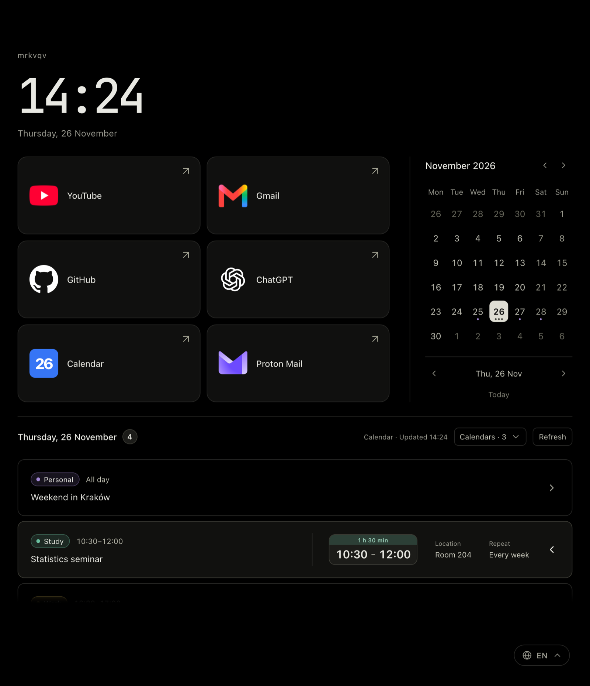

# Zen Home

[](https://github.com/mrkvqv/zen-home/releases/latest)
[](LICENSE)

A start page for [Zen Browser](https://zen-browser.app): a clock, your Zen Essentials and Apple Calendar events. Everything stays on your Mac.



## Features

- Opens at startup and with <kbd>⌃</kbd><kbd>⇧</kbd><kbd>H</kbd>, one start tab per Space.
- Essentials as cards: a click switches to the pinned tab.
- Month calendar and day agenda. Event details slide in from the right: time or dates, location, recurrence and more.
- Choose which calendars are shown.
- English, Russian, Polish and Belarusian.
- Light and dark theme from macOS.

## Install

Requires macOS 14+, Xcode Command Line Tools, Node.js 20+ and [pnpm](https://pnpm.io).

1. Download `zen-home-X.Y.Z.xpi` from [Releases](https://github.com/mrkvqv/zen-home/releases/latest) and drag it into a Zen window.
2. Install the calendar bridge — a small local app that reads Apple Calendar and Essentials:

   ```sh
   git clone https://github.com/mrkvqv/zen-home.git && cd zen-home
   pnpm install
   pnpm bridge:install
   open ~/Applications/"Zen Calendar Bridge.app"   # allow Calendar access once
   launchctl bootstrap gui/$(id -u) ~/Library/LaunchAgents/local.zen-calendar-bridge.plist
   ```

3. Run `pnpm bridge-key`, open the start page and paste the key.

The bridge listens only on `127.0.0.1`, needs this key and never writes to your calendar.

## Development

Load `src/manifest.json` in `about:debugging` → **Load Temporary Add-on**. Release builds of Zen need a signed copy: run `pnpm build` and upload the `.zip` to [addons.mozilla.org](https://addons.mozilla.org/developers/) as an unlisted add-on.

| Command            | What it does                      |
| ------------------ | --------------------------------- |
| `pnpm start`       | runs Zen with a temporary profile |
| `pnpm lint`        | checks the extension              |
| `pnpm build`       | builds the `.zip` in `dist/`      |
| `pnpm bridge:test` | checks that the bridge is running |

## License

[MIT](LICENSE). JetBrains Mono is under the [SIL Open Font License](src/assets/fonts/OFL.txt).
